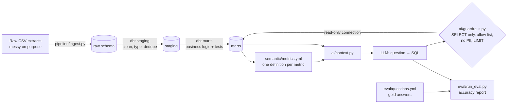

# AI-Ready Data Foundation

**Messy e-commerce extracts → tested dbt warehouse → semantic layer → a guarded "ask your data" AI assistant with a measurable accuracy score.**

Most "chat with your data" demos skip the hard part. LLMs give confident, wrong numbers when the data underneath is messy and "revenue" has no agreed definition. This project shows the foundation that makes AI answers trustworthy: clean, tested models, one definition per metric, and guardrails plus an evaluation set that show how reliable the assistant is.

## Architecture



## What makes it "AI-ready"

| Problem in real client data | How this project handles it |
|---|---|
| Same customer exported twice | `stg_customers` keeps the latest row per `customer_id` |
| `NYC`, `new york `, `New York` | `city_aliases` seed + normalisation |
| `Delivered` / `DELIVERED` / ` delivered ` | normalised status + `accepted_values` test |
| Order lines with quantity ≤ 0 | flagged in staging, excluded from marts |
| Payments that don't match the order | `assert_payments_reconcile` test (warns, reports gaps) |
| "Revenue" means different things | `semantic/metrics.yml`: one expression + filter per metric |
| LLM may run destructive or leaky SQL | SQL parsed with `sqlglot`: SELECT-only, table allow-list, PII blocked, auto-LIMIT, read-only DB with external access off |
| "Is the AI right?" | Evaluation set compares AI results to hand-written gold answers |

## Quickstart

```bash
python -m venv .venv && source .venv/bin/activate
make setup          # pip install -r requirements.txt
make pipeline       # generate -> ingest -> dbt seed/build/docs
make test           # unit tests (guardrails, semantic layer consistency, generator)
make eval-gold      # verify gold queries against the warehouse

export ANTHROPIC_API_KEY=...        # optional: ANTHROPIC_MODEL=<model id>
make context                         # see exactly what the model is given
make ask Q="Which 3 categories made the most net revenue in Q3 2026?"
make eval                            # accuracy report -> eval/report.md
make docs                            # dbt docs + lineage graph in the browser
```

Example output:

```
SQL:
SELECT category, ROUND(SUM(net_amount), 2) AS net_revenue
FROM marts.fct_order_items
WHERE is_revenue_order AND order_date >= '2026-07-01' AND order_date < '2026-10-01'
GROUP BY category ORDER BY net_revenue DESC LIMIT 3

Metric definitions used: category_net_revenue
```

## Project structure

```
scripts/generate_data.py        synthetic, deliberately messy source data (seeded, reproducible)
pipeline/ingest.py              land CSVs into raw.* (all VARCHAR, _loaded_at stamp)
pipeline/run.py                 one-command orchestration (swap for Airflow/Prefect/Dagster)
dbt/models/staging/             typing, cleaning, dedup, source freshness
dbt/models/marts/               fct_orders, fct_order_items, dim_customers, dim_products
dbt/tests/                      reconciliation test
semantic/metrics.yml            metric definitions, dimensions, rules for the AI
ai/context.py                   builds LLM context from dbt YAML + semantic layer
ai/guardrails.py                SQL validation
ai/ask.py                       CLI assistant
eval/                           gold questions + scorer
tests/                          pytest suite
```

## Taking it to a client stack

* **Warehouse:** add a `prod` BigQuery or Snowflake target in `dbt/profiles.yml`. The models use portable SQL.
* **Ingestion:** replace the CSV generator with API extracts (Shopify, Stripe, HubSpot) or Airbyte/Fivetran.
* **Orchestration:** turn `pipeline/run.py` steps into an Airflow or Prefect DAG with retries and alerting.
* **BI:** point Looker Studio, Metabase or Power BI at `marts.*`. Dashboards and the AI assistant then use the same definitions.

## Results

_Run `make eval` and paste the summary from `eval/report.md` here. Clients want to see this number._
